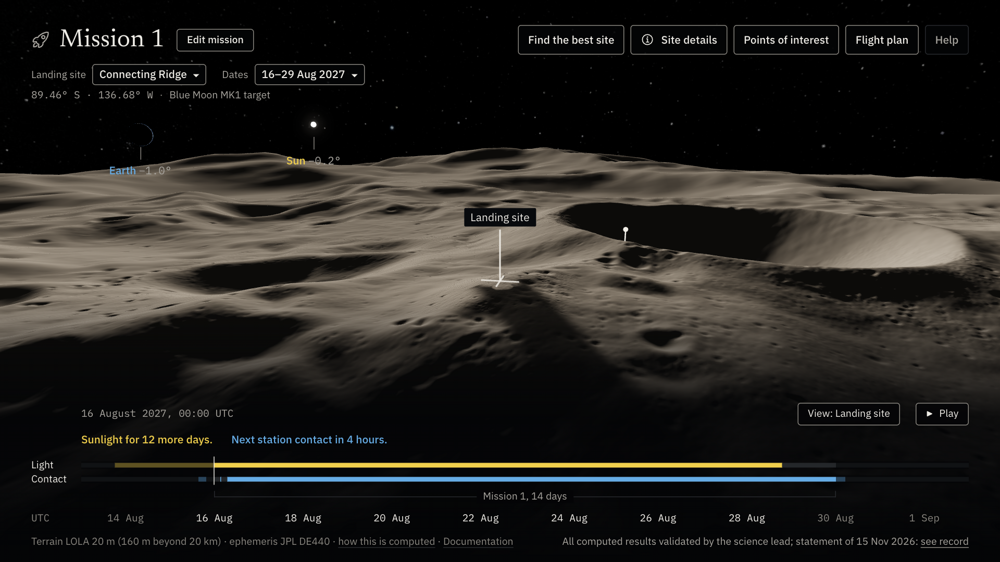

# Lunar Landing Site Navigator

A web app that compares landing sites near the Moon's south pole by sunlight and by geometric visibility of Earth ground stations, over dates the user chooses. Built by team SFZ | MEXG at NASA Space Apps 2026 (local event Heilbronn, 14–15 Nov 2026) for the challenge [Lunar Landing Site Navigator](https://www.spaceappschallenge.org/2026/challenges/lunar-landing-site-navigator/).

- Submitted state: release [1.0.0](https://github.com/ninjabaloney06-sketch/lunar-landing-site-navigator/releases/tag/v1.0.0), the repository at the submission deadline (15 Nov 2026, 23:59). `main` also holds improvements made after the deadline: release [1.0.1](https://github.com/ninjabaloney06-sketch/lunar-landing-site-navigator/releases/tag/v1.0.1), listed in [BUILD_LOG.md](BUILD_LOG.md#post-deadline-improvements-16-nov-2026).
- Hosted preview: <https://nasa.digi-works.org>, version 1.0.1 with the improvements made after the deadline; its footer and Documentation view say so (the deployed revision is recorded in [BUILD_LOG.md](BUILD_LOG.md))
- Technical and product documentation: [docs/documentation.md](docs/documentation.md), also on the app's `/docs` page with the scientific proof of each calculation ([docs/scientific-proof/](docs/scientific-proof/README.md)) and the credits
- Project page draft: [docs/event/project-page.md](docs/event/project-page.md)
- Measured check, 15 Nov 2026: Sun and Earth directions from the app's own files against JPL Horizons at 72 body-site-time pairs, largest elevation difference 0.000043° against a tolerance of 0.05° (run by an SI tool; [every pair](app/public/data/validation/horizons.json), script `scripts/tools/horizons_check.py`).
- Status of the numbers: stated as validated by the science lead on 15 Nov 2026 (no per-check sign-off; see record: [docs/event/validation.md](docs/event/validation.md#validation-status-15-nov), section "Validation status 15 Nov"), including the calculations added on 15 Nov (maximum payload, cheapest route, landing dispersion, power estimate). The statement does not say what was compared for each check; no check has a per-check sign-off written by him. The numbers were also recomputed independently by an SI tool on 14 and 15 Nov and found in agreement except where that file says otherwise. How the records relate: [docs/scientific-proof/README.md](docs/scientific-proof/README.md).

> SI marking: this README was drafted by an SI (AI) tool, Claude Code, on 14 Nov 2026 from the repository's own files. See [AI/SI use](#aisi-use).



Screenshot of the live app, 15 Nov 2026.

## What the app answers

The question a mission planner asks when a schedule slips: at this site, in this period, when is there sunlight, and when is at least one of my ground stations geometrically visible?

A fresh URL opens on the demo question: Connecting Ridge (−89.46°, −136.68°; [Collins et al., LPSC 2024 #1775, Table 1](https://www.hou.usra.edu/meetings/lpsc2024/pdf/1775.pdf)), 16–29 August 2027 UTC, all five stations selected.

What you can do on main today:

- Choose a mission: name, start and end date (1 Nov 2026 to 31 Dec 2030 UTC, at most 60 days), a science goal, one of 18 sourced sites, and the ground stations to count.
- Read two sentences above the timeline: one for sunlight, one for geometric visibility of the selected stations, both for the time under the cursor.
- Scrub or play the period on a timeline with a Light track and a Contact (station contact) track.
- See the Sun and Earth over the real terrain horizon in a 3D view (globe, site) or, without WebGL, in a horizon strip.
- Rank the 18 sites for the mission's dates, stations and science goal. Sites that pass the 5° slope limit are ranked; the others are listed separately.
- Find better dates: landing times every 30 minutes within 60 days after the mission start that meet adjustable thresholds.
- See what a slip does: the same mission 1, 7 and 30 days later and at the nearest other landing site, with the change in sunlit and station contact share (Details, Dates tab, "If the mission slips").
- Compare the current view with another site or another named period.
- Download the windows as CSV and copy a link that reproduces the view.
- Set any place south of 80° S as a custom landing site (approximate numbers, marked so).
- Compare places over a whole year in the Dates tab: the current mission, saved missions, your own points and, on request, all prepared sites, one row each.
- Zoom in on the Moon to open the landing-site view, zoom out of it to return.
- Show points of interest from the cited research sources and search for sites near them.
- Read the site assessment (slope, roughness, nearest permanent shadow, temperature), a first power estimate and links that open the site in NASA Moon Trek, LROC QuickMap and JPL Horizons.
- Calculate the rocket flight for a saved mission (launch, transfer, descent, return; payload, cheapest route and landing dispersion included; stated as validated by the science lead on 15 Nov 2026, no per-check sign-off; see record).

Added after this text was written: see [BUILD_LOG.md](BUILD_LOG.md).

"Station contact" in the app means geometric visibility of the selected stations at both ends of the path. It is not a working radio link. "Passes the 5° slope limit" is a project criterion on one terrain measurement; it says nothing else about a landing.

## Install and run

Needs Node.js and npm. Tested on macOS with Node 26.13.0 and npm 11.20.0; Vite 8.3.5 requires Node ^20.19 or ≥ 22.12 (`app/package-lock.json`). The app is static: no backend, no database, no account. All data it needs is in `app/public/`.

```sh
cd app && npm ci && npm run dev
```

Vite prints the local address (default `http://localhost:5173/`).

Production build (output in `app/dist/`):

```sh
npm run build
```

## Tests

Run from `app/`:

```sh
npm test
```

```sh
npx playwright test
```

`npm test` runs the unit tests (vitest; 645 passed on 15 Nov 2026 on the build machine; 10 more pin flight results bit for bit and pass only on the laptop they were recorded on). `npx playwright test` starts its own dev server on port 5180 (or `PW_PORT`) and runs the end-to-end tests in Chromium (last full run logged on 15 Nov 2026: 124 passed, 1 skipped by design; the specs added later that day were run on their own, see BUILD_LOG.md). Counts of the final gate: see BUILD_LOG.md, 15 Nov. It needs Playwright's Chromium, installed once with `npx playwright install chromium` (not run here: the browser was already installed on the test machine, and installing it is a download). The 3D tests render with SwiftShader (software WebGL) by default; on a machine where that is too slow (a Windows laptop: the S3 fly test exceeded its 400 s timeout), `PW_GPU=1 npx playwright test` renders on the machine's own GPU instead (127 tests in about 2.6 min on a Radeon 860M, 15 Nov 2026).

## Data pipeline (Python)

The JSON and terrain files in `app/public/data/` and the textures in `app/public/textures/` are committed, so the app runs without this step. The pipeline regenerates them from raw NASA data.

Needs Python ≥ 3.12 ([docs/reference/setup.md](docs/reference/setup.md)); tested with Python 3.14.10. Run from the repository root:

```sh
python3 -m venv .venv
```

```sh
source .venv/bin/activate
```

```sh
python -m pip install -r scripts/requirements.lock.txt
```

```sh
python -m pytest scripts/tests -q
```

Without raw data the tests that need it are skipped (184 passed, 22 skipped). With `CLPS_DATA` set, all run (206 passed).

To regenerate data, download the raw files listed in [docs/reference/data-sources.md](docs/reference/data-sources.md) (about 6.6 GB; URL, size and SHA-256 per file) into one folder with the sub-folders `spice/`, `lola/`, `illumination/`, `diviner/` and `textures/`, as in the register's "Path under root" column. Then:

```sh
export CLPS_DATA=/path/to/clps
```

| Command | Writes | Run on 14 Nov 2026 |
|---|---|---|
| `python scripts/ephemeris.py` | `app/public/data/ephem/YYYY-MM.json`, Nov 2026 to Dec 2030 | not run here: the output is over 10 MB, which needs the team lead's approval under [AGENTS.md](AGENTS.md) |
| `python scripts/ephemeris.py --site -89.46 -136.68 --start 2026-11-14T00:00 --end 2026-11-14T02:00 --step 60` | nothing; prints a direct SPICE table for one site | exit 0 |
| `python scripts/horizon.py --all` | `horizons/<site>.json` for every site in `scripts/sites.csv` | exit 0, files identical to the committed ones |
| `python scripts/sites.py` | `sites.json` from `scripts/sites.csv`, the horizons and `scripts/site_potential.json` | exit 0, identical |
| `python scripts/stations.py` | `stations.json` from `scripts/stations.csv` | exit 0, identical |
| `python scripts/periods.py` | `periods.json` | exit 0, identical |
| `python scripts/terrain_tiles.py` | `terrain/` tiles and levels for the 3D view | not run here: the output is over 10 MB (same rule) |
| `python scripts/textures.py` | `app/public/textures/` | exit 0, identical |
| `python scripts/assessments.py` | `assessments.json` | exit 0; only `meta.generated_utc` differs |
| `python scripts/export_fixtures.py` | `app/src/test/fixtures.json` (test fixtures) | exit 0, identical (file regenerated on 14 Nov 2026 with the sites' terrain heights) |

Order: `horizon.py` before `sites.py`; `sites.py` and `ephemeris.py` before `assessments.py` and `export_fixtures.py`. Docker is not used anywhere.

## Data sources and licences

Every raw file with its URL, version, size, SHA-256 and licence note is in [docs/reference/data-sources.md](docs/reference/data-sources.md). Summary of what the app and its pipeline use:

| Dataset | Version | Used for | Licence / required citation |
|---|---|---|---|
| NAIF SPICE kernels: [de440s.bsp](https://naif.jpl.nasa.gov/pub/naif/generic_kernels/spk/planets/de440s.bsp), [naif0012.tls](https://naif.jpl.nasa.gov/pub/naif/generic_kernels/lsk/naif0012.tls), [pck00011.tpc](https://naif.jpl.nasa.gov/pub/naif/generic_kernels/pck/pck00011.tpc), [moon_pa_de440_200625.bpc](https://naif.jpl.nasa.gov/pub/naif/generic_kernels/pck/moon_pa_de440_200625.bpc), [moon_de440_250416.tf](https://naif.jpl.nasa.gov/pub/naif/generic_kernels/fk/satellites/moon_de440_250416.tf) | DE440; naif0012; pck00011; Moon FK Apr 2025 | Sun and Earth positions, Moon and Earth orientation | No licence file; attribute NASA/JPL/Caltech |
| LOLA south-pole elevation model [LDEM_80S_20MPP_ADJ.TIF](https://pgda.gsfc.nasa.gov/data/LOLA_20mpp/LDEM_80S_20MPP_ADJ.TIF) | Barker et al. 2023, 80° S to 90° S, 20 m/px | Terrain horizon, site height and slope, 3D terrain, site assessments | Cite Barker et al. 2023 ([doi:10.3847/PSJ/acf3e1](https://doi.org/10.3847/PSJ/acf3e1)) and data [doi:10.60903/gsfcpgda-lola-spole](https://doi.org/10.60903/gsfcpgda-lola-spole) |
| LOLA south-pole elevation model [LDEM_60S_120MPP_ADJ.TIF](https://pgda.gsfc.nasa.gov/data/LOLA_20mpp/LDEM_60S_120MPP_ADJ.TIF) | Barker et al. 2023, 60° S to 90° S, 120 m/px | Terrain horizon beyond the edge of the 20 m model | Cite Barker et al. 2023 ([doi:10.3847/PSJ/acf3e1](https://doi.org/10.3847/PSJ/acf3e1)) and data [doi:10.60903/gsfcpgda-lola-spole](https://doi.org/10.60903/gsfcpgda-lola-spole) |
| LOLA polar elevation model [ldem_875s_5m.img](https://pds-geosciences.wustl.edu/lro/lro-l-lola-3-rdr-v1/lrolol_1xxx/data/lola_gdr/polar/img/ldem_875s_5m.img) | PDS LOLA GDR V2.0, 87.5° S to 90° S, 5 m/px | Site assessments (slope, roughness) where it covers the site | PDS: free use; attribute NASA/LOLA team and PDS Geosciences Node; no licence file in the bundle |
| LOLA average Sun-visibility maps [avgvisib_85s_060m_201608](https://pds-geosciences.wustl.edu/lro/lro-l-lola-3-rdr-v1/lrolol_1xxx/extras/illumination/release_2016/img/avgvisib_85s_060m_201608.img), [AVGVISIB_75S_120M_201608](http://imbrium.mit.edu/EXTRAS/ILLUMINATION/IMG/AVGVISIB_75S_120M_201608.IMG), [avgvisib_65s_240m_201608](https://pds-geosciences.wustl.edu/lro/lro-l-lola-3-rdr-v1/lrolol_1xxx/extras/illumination/release_2016/img/avgvisib_65s_240m_201608.img) | 2016 release; 60 m, 120 m, 240 m | Site assessments (zero-visibility shadow clusters); overlay images generated with the terrain tiles | Cite Mazarico et al. 2011 (Icarus 211, 1066–1081, [doi:10.1016/j.icarus.2010.10.030](https://doi.org/10.1016/j.icarus.2010.10.030)) |
| LRO Diviner Polar Resource Product [dlre_prp_south.tab](https://pds-geosciences.wustl.edu/lro/urn-nasa-pds-lro_diviner_derived1/data_derived_prp/dlre_prp_south.tab) | LRO-L-DLRE-5-PRP-V2.0 | Site assessments (annual mean and maximum temperature) | No licence terms in the labels; public NASA PDS data under NASA SMD policy [SPD-41a](https://science.nasa.gov/researchers/science-data/science-information-policy/). Cite "Paige et al., LRO DLRE LEVEL 5 PRP V2.0, NASA Planetary Data System, LRO-L-DLRE-5-PRP-V2.0, 2018" |
| NASA SVS CGI Moon Kit: [lroc_color_poles_4k.tif](https://svs.gsfc.nasa.gov/vis/a000000/a004700/a004720/lroc_color_poles_4k.tif), [ldem_16_uint.tif](https://svs.gsfc.nasa.gov/vis/a000000/a004700/a004720/ldem_16_uint.tif), [ldem_4.tif](https://svs.gsfc.nasa.gov/vis/a000000/a004700/a004720/ldem_4.tif) | SVS 4720 | Moon colour and normal map in the 3D view; `ldem_16` also fills the far terrain outside the polar model; `ldem_4` only to check `ldem_16`'s encoding | Credit NASA's Scientific Visualization Studio and the LRO/LROC/LOLA teams |
| NASA SVS Deep Star Maps [starmap_2020_4k.exr](https://svs.gsfc.nasa.gov/vis/a000000/a004800/a004851/starmap_2020_4k.exr) | SVS 4851, 2020 | Star background in the 3D view | Credit NASA/Goddard Space Flight Center Scientific Visualization Studio |
| Blue Marble Next Generation [world.200411.3x5400x2700.jpg](https://assets.science.nasa.gov/content/dam/science/esd/eo/images/bmng/bmng-base/november/world.200411.3x5400x2700.jpg) | November 2004 base map | Earth texture in the 3D view | Credit NASA Earth Observatory (Stöckli et al.) |

NASA media, including texture maps, are "generally not subject to copyright in the United States"; NASA must be acknowledged as the source and use must not imply endorsement ([NASA Images and Media Usage Guidelines](https://www.nasa.gov/nasa-brand-center/images-and-media/), read 14 Nov 2026). Credits for the four processed texture files: [app/public/textures/CREDITS.md](app/public/textures/CREDITS.md).

Downloaded and registered, not used by the app or the pipeline: the three Earth-visibility maps (`*_earth`), `lroc_color_2k.jpg`, `lroc_color_poles_8k.tif`, `starmap_2020_4k_print.jpg`, and the comment file `moon_pa_de440_200625.cmt`.

Other sourced inputs, kept in the repository as small text files. They are not rows of `data-sources.md`, and no licence statement for them is recorded in the repository yet:

- Ground stations, `scripts/stations.csv`: three NASA Deep Space Network antennas from [DSN 810-005, module 301, Rev P](https://deepspace.jpl.nasa.gov/dsndocs/810-005/301/301P.pdf); two JAXA antennas from the [JAXA Station Coordinates page](https://ddor.nav.isas.jaxa.jp/station_coordinates/).
- Sites, `scripts/sites.csv`: each row carries its own source link ([Collins et al., LPSC 2024 #1775](https://www.hou.usra.edu/meetings/lpsc2024/pdf/1775.pdf); [NASA Lunar Surface Data Book, table A2-2](https://ntrs.nasa.gov/api/citations/20230007818/downloads/ACD-50044%20Lunar%20Surface%20Data%20Book%20Rev%20A.pdf); [NASA LRO on IM-1](https://www.nasa.gov/missions/lro/nasas-lro-images-intuitive-machines-odysseus-lander/); [LROC image 1401](https://lroc.im-ldi.com/images/1401); [Beyer et al. 2025](https://iopscience.iop.org/article/10.3847/PSJ/ae061a)).
- Site potential, `scripts/site_potential.json`: 56 entries, each with an evidence label and a source link shown in the app.
- Validation reference: [JPL Horizons](https://ssd.jpl.nasa.gov/horizons/), through the request links in [docs/event/validation.md](docs/event/validation.md).

Software (licences as recorded in `app/package-lock.json`): React 19.3.1 (MIT), three.js 0.170.0 (MIT), D3 7.9.0 (ISC), Ionicons 8.1.0 (MIT), fonts IBM Plex Sans, IBM Plex Mono and Newsreader via @fontsource 5.3.0 (OFL-1.1); build and test tools Vite 8.3.5 (MIT), Vitest (MIT), Playwright 1.64.0 (Apache-2.0), TypeScript (Apache-2.0). Python packages and versions: `scripts/requirements.lock.txt`.

## AI/SI use

Space Apps calls AI tools "SI". This project was built with them, and says so here, in the app's Terms of use and in the log.

- **Tools:** Claude Code (Anthropic; models Claude Fable 5.2, Opus 5.5 and Haiku 5.5), Codex (OpenAI), and before the event also ZCode and VS Code chat for planning documents; Whisper large-v3-turbo for transcribing the kickoff recordings locally.
- **What SI tools wrote:** the app code (`app/`), the data pipeline and its tests (`scripts/`), the generated JSON and terrain files (by running that pipeline on the NASA data above), the planning documents, and this README, the documentation and the project-page draft.
- **What people did:** chose the scope, the demo site, the slope criteria and the station set; ran the timed test of the existing tools; approved the Terms of use text and each download; approved the look of the user interface; reported the results of validation checks V1 and V2 and of the review of the site-assessment code and numbers. The approval of the look and these results are recorded as reported by a team member. On 15 Nov the science lead stated in chat that he had validated everything; [validation.md](docs/event/validation.md#validation-status-15-nov) records that statement, without a per-check sign-off written by him.
- **How SI output was checked:** automated tests (vitest, pytest, Playwright), a cross-language fixture test that pins the browser code to the Python reference, a comparison against JPL Horizons, and independent review sessions before merges. Each session, its errors and what was rejected: [docs/event/ai-use-log.md](docs/event/ai-use-log.md).
- **Not SI-generated:** the NASA and JAXA source data. No SI-generated image, video or audio is part of the app.

## Known limits

Full list with the resolution of each result: [docs/documentation.md, Limits](docs/documentation.md#limits).

- Station contact is geometric visibility of the selected stations, at both ends. No link budget, antenna schedule, weather or equipment is modelled.
- Every validation check that existed at about 08:50 on 15 Nov 2026 is stated as validated by the science lead on 15 Nov 2026 (no per-check sign-off; see record: [docs/event/validation.md](docs/event/validation.md#validation-status-15-nov)); no item has a written sign-off, and the statement does not say what was compared. What was built after the statement (the SLS Block 1 parking orbit as flown on Artemis I, the "If the mission slips" rows and year rows as displayed, the slope warning thresholds as displayed, the terrain shadow and lighting rendering choices) is not yet validated by the science lead. Before it, V1 and V2 were recorded as passed as reported and the station check and V3 to V9 were open. An independent recomputation by an SI tool (14 Nov) agrees with the app for positions, horizons, sunlight and station contact; on that basis the team removed the app's "not validated" marker. In that first recheck, slope, the PGDA comparison, the finder ranking and whole-year mode were not rechecked. A second AI recheck on 15 Nov covered window edges, coarse terrain, interface values, the finder (it found a window the old 6-hour candidate grid missed; the finder now tries every 30 minutes), station geometry and slopes; it is not a sign-off either.
- The 18 listed sites are representative points of regions, not chosen landing points. Other places south of 80° S can be set as custom landing sites; their numbers come from coarser terrain computed in the browser and are marked approximate, not validated. North of 80° S only the listed sites can be analysed.
- The 20 m terrain model ends at 80° S; beyond it the horizon search continues on a 120 m model of the same product. Only IM-1, about 4 km from that edge, has skyline directions (52 of 720) that come from the coarser model.
- The slope shown is one measurement over a 100 m baseline on the 20 m terrain model, compared with a project criterion of 5°.
- The site assessments (slope statistics, roughness, shadow access, temperature) are shown in the Details drawer for the 18 listed sites, not for custom sites.

Added after this text was written: see [BUILD_LOG.md](BUILD_LOG.md).

## Repository layout

| Path | Contents |
|---|---|
| `app/` | React + TypeScript frontend, its tests, build and deploy configuration |
| `app/public/data/` | Generated JSON and terrain files the app loads |
| `scripts/` | Python data pipeline, lock file, `scripts/tests/` |
| `docs/documentation.md` | Technical and product documentation |
| `docs/event/` | Spec, validation, AI-use log, project-page draft, plans for the event weekend |
| `docs/reference/` | Data register, sources, background, decisions |
| `docs/archive/` | Finished audits and checklists |

Working files of the team: [BUILD_LOG.md](BUILD_LOG.md) (what was done, with times and commits), [AGENTS.md](AGENTS.md) (rules for AI agents in this repository), [docs/event/spec.md](docs/event/spec.md), [docs/event/build-plan.md](docs/event/build-plan.md), [docs/reference/decisions.md](docs/reference/decisions.md).

## Licence

Code and original text: Apache License 2.0 ([LICENSE](LICENSE)). Third-party data keeps its own terms and citations, listed above. This project is not made, endorsed or reviewed by NASA.
