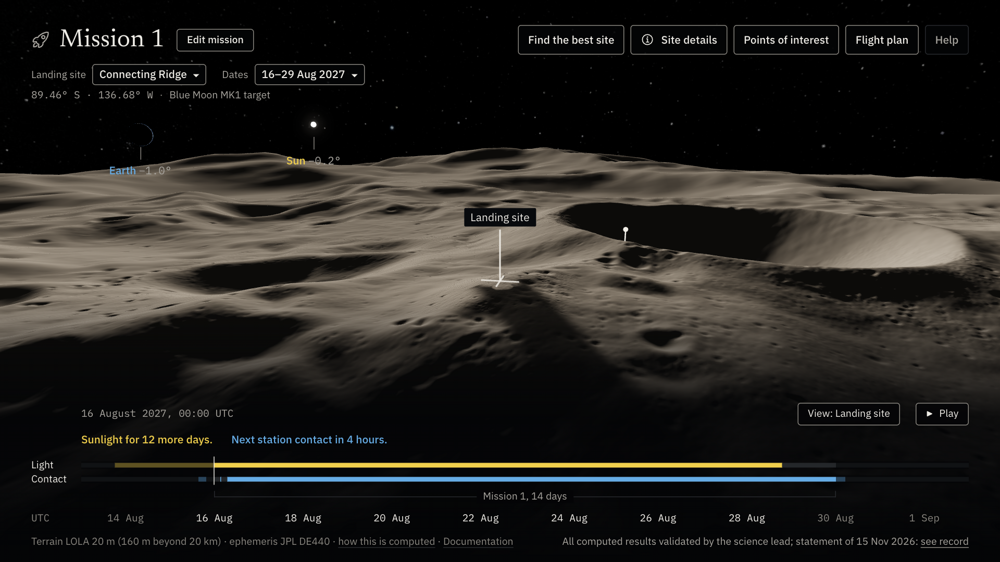

# Pitch outline and backup deck

Drafted 13 Nov before the event on ninja's decision (exception to the pre-event rule, see [decisions.md](../reference/decisions.md)). Problem, approach and limits come from work done before the event. Everything about the built app is a **[Sunday]** slot: fill it from [validation.md](validation.md), the checkpoint clips and the final app. Never show a placeholder at the pitch.

`python3 scripts/tools/make_pitch_pdf.py` turns the slide section below into `docs/event/pitch-backup-slides.pdf`. Edit this file, not the PDF. Format the script reads: `## Slide N · Title`, then `- ` bullets, then an optional `Say:` line (speaker notes, not printed on slides).

Rules: at most 7 slides (2022 demo limit, until the 2026 guide says otherwise; submission-check-13nov.md). No names, photos or voices of team members (all under 18). Every number below has its source in the repo; do not add numbers that have none.

## 30-second spoken version (demo video and pitch opening)

Order from the 2022 "30 Seconds of Glory" template (past-winners.md, P6): challenge → problem → live app answering the question → why it matters.

1. (0–5 s) "Landing at the lunar south pole, a mission needs two things: sunlight for power and a line of sight to Earth for radio."
2. (5–12 s) "We asked three NASA tools one question: at Connecting Ridge, 14 to 28 November, when do we get both? Fourteen minutes later: one wrong answer, two dead ends."
3. (12–25 s) Live app: pick Connecting Ridge, 16–29 Aug 2027 (the confirmed demo question, spec.md) → Sun and Earth over the real horizon, windows for light, Earth and both. The app answers for 16 Aug 2027, 00:00 UTC: "Sunlight for 12 more days. Next station contact in 4 hours." (read from the live app on 15 Nov 2026).
4. (25–30 s) "Every number is checked against JPL Horizons and comes with its source."

## Slides

## Slide 1 · Lunar Landing Site Navigator
- When does a south-pole landing site have sunlight and a line to Earth?
- NASA Space Apps Challenge 2026 · Heilbronn · Team SFZ | MEXG
- Live app: nasa.digi-works.org
Say: One sentence on the challenge, then straight to the question.

## Slide 2 · One question every south-pole mission asks
- At the south pole the Sun circles the horizon within about ±1.6° and never climbs higher (NASA SVS 2026 data).
- Earth stays within about ±7° of the horizon and drops below it for part of each ~27-day cycle (libration, NASA SVS).
- So light and radio contact depend on the terrain around the site, hour by hour.
- Our test question (confirmed in spec.md, 14 Nov): Connecting Ridge (−89.46°, −136.68°), 16–29 Aug 2027 UTC. When is it sunlit, and when can at least one selected Earth station reach it? (The earlier 14–28 Nov 2026 case stays a regression check.)
Say: Lighting at the pole is a terrain question, not a calendar question.

## Slide 3 · Today's tools do not answer it
- JPL Horizons: 6:11 min, a complete table that looked right and was wrong (observer resolved to an observatory in Ohio).
- NASA Moon Trek: gave up after 5:00, lighting tool needs an account and a different projection.
- LRO QuickMap: 3:00, good map, the site is outside the default projection, no Sun or Earth numbers.
- About 14 minutes across three NASA tools: one wrong answer, two dead ends.
Say: First-time user, timed run on 27 Oct, screenshots in our repo.

## Slide 4 · Pick a site and a date, get the answer
- Sun and Earth over the site's real terrain horizon; one timeline for sunlight and station contact.
- When the launch slips: the same mission 1, 7 and 30 days later, better dates, and all 18 sites ranked.
- 
Say: Show it live here. If the live demo fails, this slide and the recording are the backup.

## Slide 5 · How it works
- Sun and Earth positions: NASA/JPL SPICE (DE440 ephemeris, lunar orientation kernels, MOON_ME frame).
- Terrain horizon: LOLA south-pole elevation model (Barker et al. 2023, 20 m/px), rays in 720 directions out to 300 km, including lunar curvature.
- Static web app: computed in Python, shown with three.js and D3. No account, no backend.
- Every number carries its source and its limits.
Say: Keep this to 15 seconds unless judges ask.

## Slide 6 · How we checked the numbers
- Sun and Earth angles compared against JPL Horizons with an observer on the lunar surface. Target: under 0.05°.
- Horizon results cross-checked against published illumination maps where the definitions match (Mazarico et al. 2011).
- Measured on 15 Nov: 72 comparisons at three sites over 2027–2030, largest elevation difference 0.000043° (run by an SI tool, every pair in the repo).
- Sunlit share at all 18 sites against the published maps: within 9.0 percentage points (context only: different periods).
- The science lead's statement of 15 Nov covers every check; there is no per-check written sign-off.
Say: Our science lead answers the physics questions.

## Slide 7 · Limits and next steps
- Station contact is geometric visibility of the chosen stations, not a radio link.
- Not modelled: temperature during the mission, boulders, rover routes. South polar region and Nov 2026 to Dec 2030 only.
- Open source (Apache 2.0); data from NASA, NAIF and PGDA, cited on the project page.
- Next: check the terrain horizon against LROC photographs, and replay real south-pole landings (IM-1, IM-2, Chandrayaan-3).
Say: Close on why it matters: the right landing date is a power and comms decision.
